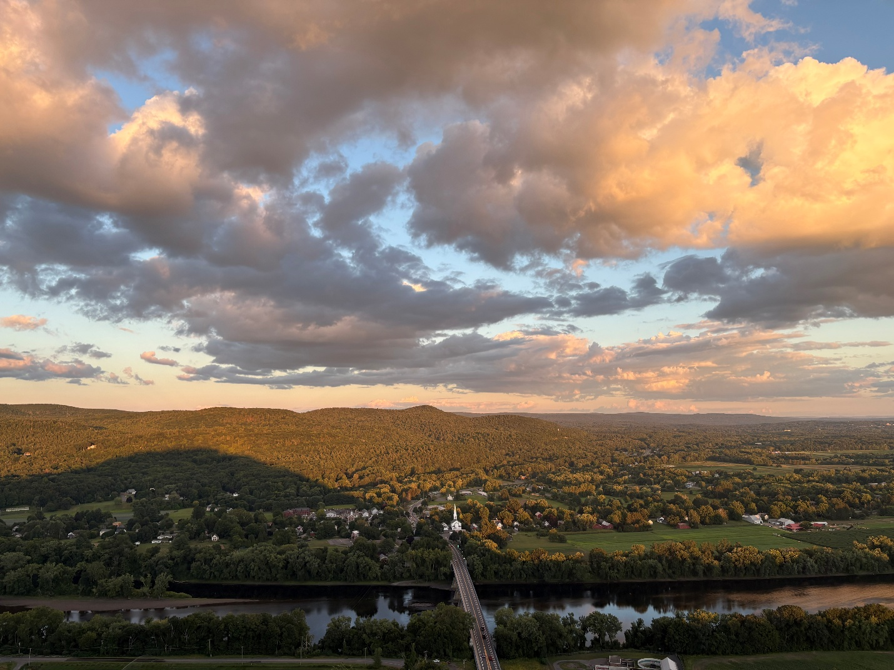

写到最后，我又回到了标题页。我想，文字是自由的，它应该飞得高，也应该能指路。这是现在的我给未来的自己发送的坐标。等收到时，它就来自过去了。

把生活概括成“两点一线”，总会省略太多。工作，睡觉，再去工作，听起来乏味得无可辩驳。但有时候，这甚至算不上对生活的概括，只是一句抱怨。至少对我来说，偶尔也是抢先自嘲一下，好让别人无从嫌弃。

如果把Conte和家写成两个点，省略的东西实在太多；把通勤的四英里画成一根线，又好像把距离拉得太长。何况，得到这样的两点一线，也不是一件轻而易举的事。

毫不夸张地说，我在Conte A332的工位，是努力、运气，以及许多我无法左右的因素共同作用的结果。我从来不觉得，得到它很简单。它也不只是一个工位。我在那里享受着追求自由的快乐，也期待着它把我带往下一个地方。它不是一个点，更像一个尚未坍缩的波函数：还没有确定的下一站，却包含着许多可能。

可能性是最美好的东西。

但我的心还很贪婪。我想让两个点中间的那根线，也变得有趣一点。

所以，我想买自行车了。

用AI做了很多的功课，决定买Specialized Sirrus X 3.0。清仓价应该在七百美元左右，换成人民币，快五千块了。不便宜呢。

Sirrus对我来说，无疑是奢侈消费。但好奇心还是迫使我点进Specialized的官网，探索更多可能性。我想知道，AI是不是太看得起我的消费能力了，或许还有更适合我的。

其实没有。Sirrus藏在许多四位数价格的系列里，我翻到最后才发现，原来它已经算是相对经济的款式。

AI还是懂事的。

我想了很多个买它的良辰吉日，却始终还在犹豫。

再等等吧。最近很忙，开车更省时间，时间太宝贵了。时间会越来越贵，车会越来越便宜。现在天气已经冷了，买回来也骑不了多久，冬天就到了。明年再买，更划算。

所以我可以一直等，等到自己不再需要它。

对了，还得等到自己愿意放假。对了，Sirrus没有后座。生产商已经替我考虑过了。

这很难，我对当前的两点一线爱得深沉。

Sirrus到底是什么意思？

听发音，它有点像Cirrus，但真去字典里查，字典又以为我想说的是Sirius。要是跟着轻声念出来，Siri可能也该弹出来了。它也不理解。

卷云和天狼星，都是很好的意味。Cirrus轻快，自由。Sirius是夜空中最亮的星。从地上看，我总觉得它像天上的流浪汉。不知道要往哪里去，但很亮，也很自由。

第一次准备组会汇报的时候，我在Google Maps上画过自己的轨迹，密密麻麻。但加上PVG到DTW的那趟航班，再把地图缩小，之前的轨迹就几乎变成了一个点。

我不知道下一站会去哪里。很多人都不知道。为什么这样一件本该习以为常的事，还是会让人迷茫？

抬头看看星星和云。它们是夜晚和白天的路，交替着，就到了明天。

::: {.essay-signature}
昕宇  
Amherst, MA  
September, 2026
:::

