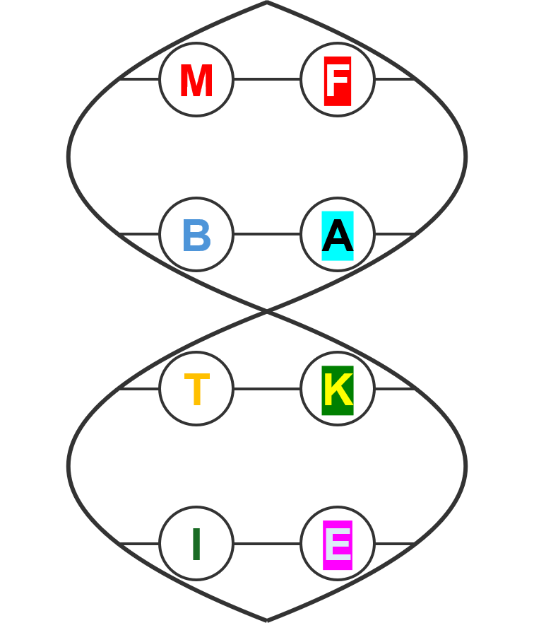

Personality is a big lie. Or, more precisely, the lie is that a personality label tells us who we are, what we are capable of, and how exceptional we are. There is something amusing about the prestige attached to personality types such as INTJ, INTP, and ENTJ. People seem remarkably pleased to discover that they supposedly share a personality type with Einstein, Newton, or some billionaire entrepreneur. Curiously, they rarely show the same enthusiasm for looking up the alleged personality types of Hitler, Stalin, or Kim Jong Un. For my Chinese readers, may I suggest looking up Mbappé and Mao as well, just to broaden the sample size? If sharing four letters with a genius makes you intellectually superior, should sharing them with a dictator make you morally suspect? The absurdity of the latter should tell us something about the absurdity of the former.

But intellectual vanity is perhaps the less harmful consequence of believing too much in personality labels. What concerns me more is how readily we use them to justify our weaknesses and limit our potential. There is a peculiar irony in this: people eagerly take credit for the strengths attributed to their personality type while disclaiming responsibility for its weaknesses.

**Four letters may describe some of your habits. They should never determine the limits of the person you can become.**

I believe the most capable people are not those who perfectly embody a personality type, but those who can adapt their thinking and behavior to different circumstances. Such adaptability takes resilience and courage.

Resilience means rejecting fatalism, maintaining a sense of possibility even when the present offers little reason for optimism, and never giving up on self-improvement. Courage means stepping beyond our natural tendencies despite the risk of failure or embarrassment.

It may be an introvert initiating a conversation at a social event or simply making small talk in an elevator. It may be an outgoing but impulsive person sitting alone in a quiet room to reflect before making a regrettable decision. It may be an emotionally sensitive person attending to an urgent responsibility before wiping away their tears. It may be someone accustomed to relying on intuition, whose vision of the future has become unbearably bleak, choosing instead to focus on the practical details of the present, reason from available evidence, and find a way forward.

None of this requires us to deny our personality, only to refuse to be governed by it.

**MBTI can limit not only our own development but also our understanding of other people.**

Why are we so fascinated by this game of labeling? Perhaps because it offers the comforting illusion of understanding ourselves and others without much intellectual effort. Some even treat MBTI as a bible for romantic compatibility or use it to explain why they like or dislike someone. How convenient it is to reduce the complexity of human relationships to four letters rather than take the trouble to understand another human being. A label is no substitute for understanding, just as classification is no substitute for mechanistic insight. Otherwise, biologists might as well throw away their sequencing equipment and invest in better questionnaires.

So much for the four letters. Enough playing pretend. Let's get down to business. There is a real world to confront and a better version of ourselves to build.

```{=html}
<figure class="dna-figure">
  
</figure>
```
